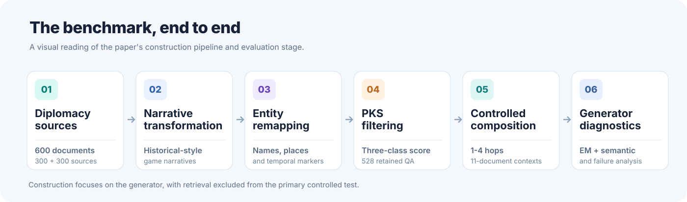
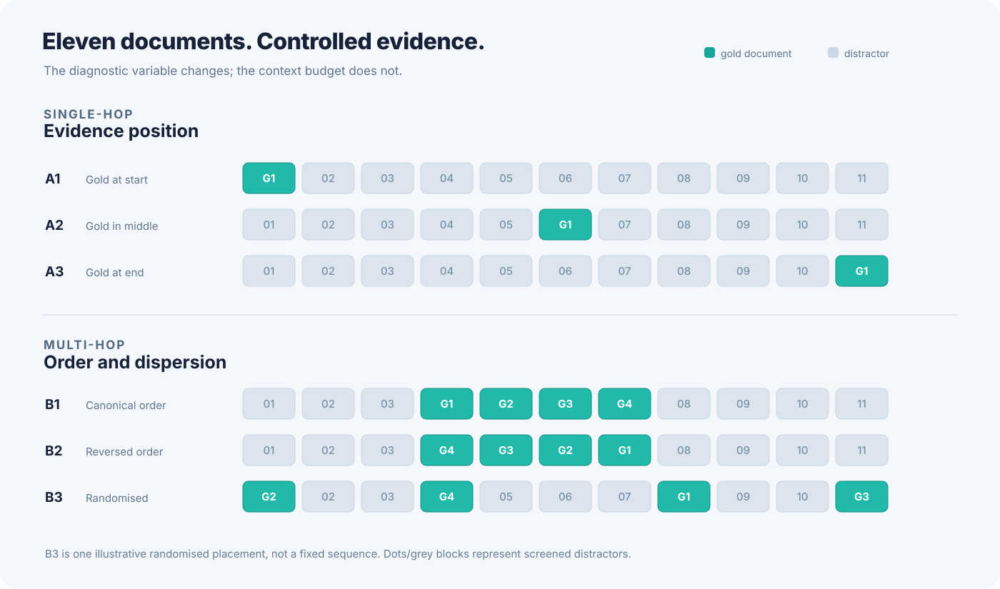

<h1 align="center">Multi-Hop RAG Diagnostics</h1>

<p align="center">
  <strong>A framework for diagnosing where multi-hop reasoning breaks in RAG generators</strong>
</p>

<p align="center">
  <a href="#overview">Overview</a> &nbsp;·&nbsp;
  <a href="#dataset-download">Dataset</a> &nbsp;·&nbsp;
  <a href="#how-it-works">Method</a> &nbsp;·&nbsp;
  <a href="#evidence-controls">Evidence controls</a> &nbsp;·&nbsp;
  <a href="#what-the-paper-finds">Findings</a> &nbsp;·&nbsp;
  <a href="#quick-start">Quick start</a>
</p>

<p align="center">
  <strong>600</strong> source narratives &nbsp;|&nbsp;
  <strong>528</strong> retained instances &nbsp;|&nbsp;
  <strong>1–4</strong> hops &nbsp;|&nbsp;
  <strong>11</strong> documents per context &nbsp;|&nbsp;
  <strong>12</strong> evaluated models
</p>


---

## Overview

This repository provides the dataset-construction, parametric knowledge filtering, and generator-evaluation code associated with *A Framework for Diagnosing Where Multi-Hop Reasoning Breaks in RAG Generators*. The benchmark tests whether language models can combine evidence across documents when the retrieved context is fixed.


### Benchmark at a glance

| Property | Design |
| :-- | :-- |
| Source material | 600 Diplomacy-derived source samples: 300 LLM-vs-LLM game samples and 300 from the QANTA Diplomacy corpus |
| Retained after PKS filtering | **528 question chains**, each with 1- through 4-hop versions |
| Reasoning complexity | 1, 2, 3, and 4 hops |
| Context budget |  **11 documents** per question |
| Evidence / distractors | 1-4 gold documents plus 10-7 screened distractors |
| Single-hop conditions | A1 (first), A2 (middle), A3 (last) |
| Multi-hop conditions | B1 (canonical), B2 (reversed), B3 (randomised) |
| Expected answers | Short, document-grounded answers of 1-3 words |
| Scoring | Deterministic generation, exact match, semantic equivalence, and diagnostic metrics |

## Dataset download

The **PKS-filtered benchmark (528 question chains) used in the paper** is available as a downloadable JSON file:

**[Download the 528-instance benchmark from Google Drive](https://drive.google.com/file/d/1GmHj2K5SCaV0-a8xFjaj9UprHv6hbmXa/view?usp=sharing)**

The file contains each chain's `original_question`, gold `answer`, reasoning `decomposition`, and the `hops` (`n1`-`n4`) with gold documents and two stored distractor pools (`relevant` and `irrelevant`). The benchmark is **already generated and PKS-filtered**. You can evaluate it directly without rerunning narrative generation, multi-hop construction, or PKS calibration.

Save the downloaded file as `data/benchmark_528.json`, or use the downloader below. The direct runner reads this JSON, constructs each context in memory, generates answers, judges them, and writes metrics. 


## How it works

<p align="center">
  
</p>

The source samples are turned into historical-style narratives, named entities and temporal markers are remapped to make surface-level memorisation less useful. Short, span-supported questions are expanded into multi-hop chains by replacing bridge entities with descriptions that must be resolved from additional documents. 


<details>
<summary><strong>Learn more: source generation and PKS filtering</strong></summary>

### Source material and transformation

- **300 LLM-vs-LLM Diplomacy game samples**, generated using the [GoodStartLabs AI_Diplomacy](https://github.com/GoodStartLabs/AI_Diplomacy) environment.
- **300 QANTA Diplomacy corpus samples**, based on the [Diplomacy dataset](https://sites.google.com/view/qanta/projects/diplomacy) (Peskov et al., 2020).


### Parametric knowledge filtering

The framework computes a no-context, PMI-inspired association score:

$$
\mathrm{PKS}(q,a) = L_q + L_a - L_{aq}
$$

Here, each $L$ is a summed token-level negative log-likelihood under a fixed reference model. The score is calibrated using three distributions: **Known & Plausible**, **Unknown & Plausible**, and **Unknown & Implausible**. The nearest class is determined by standardised distance; the **Known & Plausible** category is excluded.

</details>

## Evidence controls

<p align="center">
  
</p>

Each evaluation context contains exactly **11 documents**. This holds the document budget constant while increasing hop depth and varying gold-evidence position or ordering. 

| Hop depth | Gold documents | Distractors | Controlled conditions |
| :--: | :--: | :--: | :-- |
| 1 | 1 | 10 | A1: first, A2: middle, A3: last |
| 2 | 2 | 9 | B1: canonical, B2: reversed, B3: randomised |
| 3 | 3 | 8 | B1: canonical, B2: reversed, B3: randomised |
| 4 | 4 | 7 | B1: canonical, B2: reversed, B3: randomised |


## What the paper finds

The experiments test **12 models** under a constant document budget. The headline result is that **answer accuracy declines as required reasoning hops increase**, even when all necessary gold evidence has been supplied.

| Diagnostic question | Finding in the paper |
| :-- | :-- |
| **Does deeper reasoning matter?** | Accuracy decreases from hop 1 to hop 4 across all 12 evaluated models. |
| **Does evidence placement matter?** | Many models exhibit single-hop sensitivity to middle-positioned evidence. |
| **Does multi-hop ordering matter?** | Randomised evidence placement is often numerically stronger, but no formation comparison survives Holm correction. |
| **Where do incorrect answers come from?** | Among single-hop failures, 97.7% are classified as *distracted* and 2.3% as *fabricated* (Supplementary Material, Table 2). |
| **Where does a chain stop?** | The retained intermediate-entity trace identifies cases in which models output a bridge entity rather than the requested final answer. |


## Evaluation and diagnostic metrics

Models answer from the supplied documents in **1-3 words**. Select `legacy_short` to preserve the uploaded judging script, or `semantic_all` for the paper-described all-nonexact semantic check. The judge model is explicit; these policies can produce different scores.

| Metric | What it measures |
| :-- | :-- |
| **Accuracy (EM + judge)** | Gold-answer correctness after deterministic and semantic checks |
| **CMD** | Compliance with the 1-3 word response constraint |
| **CONFAB** | Off-task, unusable, or refusal/non-answer outputs |
| **EAR** | Correct attribution of gold supporting evidence in a separately prompted citation evaluation |
| **CCS** | Correctness at every depth of the same reasoning chain, including shallower hops |
| **DISTRACTED** | Incorrect answer appearing in a distractor document |
| **FABRICATED** | Incorrect answer absent from distractor documents under the selected lexical diagnostic |


## Quick start

The commands run from the repository root. Use Python 3.10+ and a fresh environment. The game engine has its own environment, it is not needed to evaluate the released dataset.

```bash
git clone https://github.com/rag-diagnostics/multihop-rag-benchmark.git
cd multihop-rag-benchmark
python -m venv .venv
source .venv/bin/activate
python -m pip install -r requirements.txt
python -m tools.check_environment
```

On Windows PowerShell, activate with `.venv\Scripts\Activate.ps1`. Multi-line examples below use Bash continuation characters, on PowerShell paste each command on one line.

### 1. Download and validate the released dataset

```bash
python -m tools.download_dataset --output data/benchmark_528.json --expected-chains 528
python -m evaluation.dataset --input data/benchmark_528.json \
  --distractor-family irrelevant --expected-chains 528 \
  --report runs/dataset_audit.json
```

A browser download is also supported: save the complete JSON at that path, then run `python -m tools.download_dataset --output data/benchmark_528.json --verify-only`. A Drive preview, access-denied HTML, or an incomplete pasted excerpt is not a valid dataset. The downloader records the actual SHA-256; it does not invent a publisher checksum.

### 2. Choose the model and experimental settings


```bash
python -m evaluation.evaluate_dataset \
  --dataset data/benchmark_528.json --expected-chains 528 \
  --models evaluation/model_config.original_api.example.json \
  --only-model gemini-flash-lite \
  --output-dir runs/sample_irrelevant \
  --distractor-family irrelevant --length-policy legacy_word_min \
  --judge-model gemini-2.5-pro --judge-policy legacy_short \
  --max-tokens 50 --sample-chains 2 --seed 42 \
  --dry-run
```

Remove `--dry-run` to execute generation, judging, and aggregation. For a full run, also remove `--sample-chains 2` and use a **new** output directory such as `runs/full_irrelevant`.
See the [evaluation guide](evaluation/README.md) for settings, output fields, and separate stage commands.

### 3. Inspect results

Each run directory contains `dataset_audit.json`, `run_manifest.json`, `generations.jsonl`, `judged.jsonl`, and `summary/evaluation_metrics.json`. 


### Building a new dataset instead

The [construction guide](docs/BUILD_DATASET.md) covers game simulation, message extraction, source selection, narrative generation, transformation, QA, screened random distractors, validation, multi-hop construction, and PKS. 


## Repository map

| Module | Purpose | Documentation |
| :-- | :-- | :-- |
| `data_generation/` | Diplomacy generation, narrative transformations, QA, distractor selection, and context construction | [Guide](data_generation/README.md) |
| `parametric_filtering/` | PKS calibration, three-class filtering, and cross-model checks | [Guide](parametric_filtering/README.md) |
| `evaluation/` | Direct released-JSON inference, explicit judging, and coverage-aware scoring | [Guide](evaluation/README.md) |

<details>
<summary><strong>Show the complete repository structure</strong></summary>

```text
multihop-rag-benchmark/
|-- data_generation/
|   |-- llm_diplomacy/              # LLM game simulation and message extraction
|   |-- source_collection/          # Source-collection utilities
|   |-- narrative_generation/       # Game messages to narratives
|   |-- entity_remapping/           # Entity and temporal transformations
|   |-- qa_generation/              # Base QA generation
|   |-- schema_adapters/            # Input/output schema alignment
|   |-- distractor_selection/       # Answer-screened distractors
|   |-- dataset_validation/         # Gold evidence and answer checks
|   |-- multihop_construction/      # Recursive 1-4 hop chains
|   `-- context_formation/          # Controlled A/B contexts and released JSON adapter
|-- parametric_filtering/
|   |-- baseline_calibration/       # PKS baseline scores
|   |-- pks_filtering/              # Question-level screening
|   |-- validation/                 # Reference-model checks
|   `-- pks_core.py                 # Shared score/classification logic
|-- rag_utils/                      # Lossless I/O, checkpoints, Gemini transport
|-- tools/                          # Dataset download and environment checks
|-- evaluation/
|   |-- evaluate_dataset.py         # Download/read JSON -> answers -> judging -> metrics
|   |-- run_dataset.py              # Direct-JSON generation and safe resume
|   |-- run_inference.py            # Inference across fixed contexts
|   |-- providers.py                # API and local model backends
|   |-- prompting.py                # Grounded QA prompts
|   |-- contexts.py                 # Context loading and checks
|   `-- scoring/
|       |-- matching.py             # Exact matching
|       |-- judge_answers.py        # Semantic evaluation
|       `-- aggregate.py            # Aggregation and diagnostics
|-- assets/readme/                  # Visual identity used in this README
|-- Supplementary Material.pdf
`-- README.md
```

</details>

## Supplementary material

[**Supplementary Material (PDF)**](Supplementary%20Material.pdf) provides worked multi-hop examples, dataset statistics, PKS calibration and robustness checks, full prompts and model settings, human validation, statistical analyses, live-retrieval validation, chain completion, and cross-domain replication. It also documents supplementary experiments that are separate from the core dataset-generation and evaluation code.


When reusing source gameplay data or simulation code, also follow the citation and licensing terms of [QANTA Diplomacy](https://sites.google.com/view/qanta/projects/diplomacy) and [GoodStartLabs AI_Diplomacy](https://github.com/GoodStartLabs/AI_Diplomacy).

---

<p align="center"><sub>Built for controlled evidence-grounded reasoning research, not retriever benchmarking.</sub></p>
